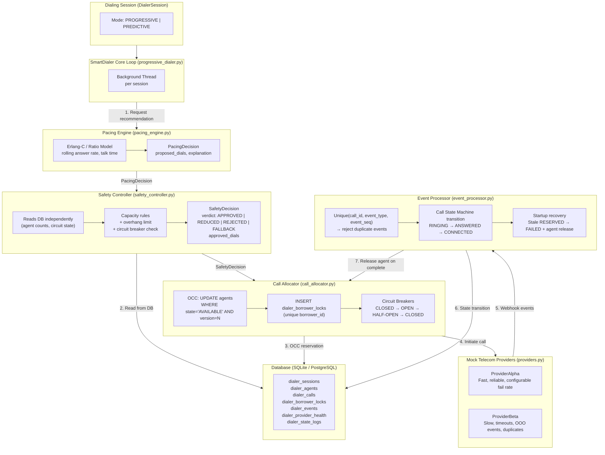
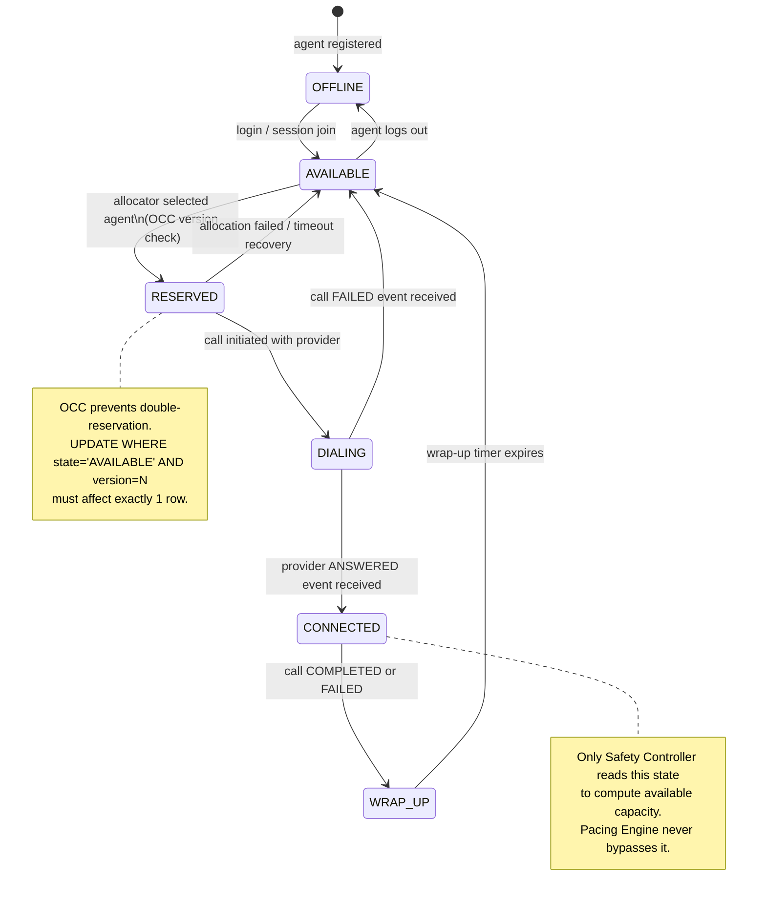
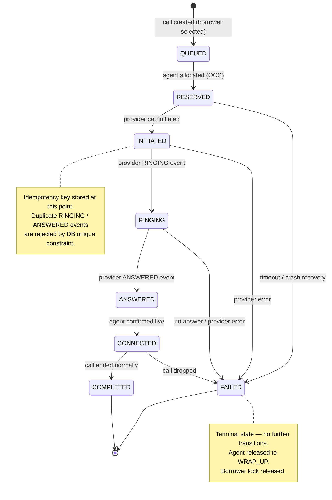
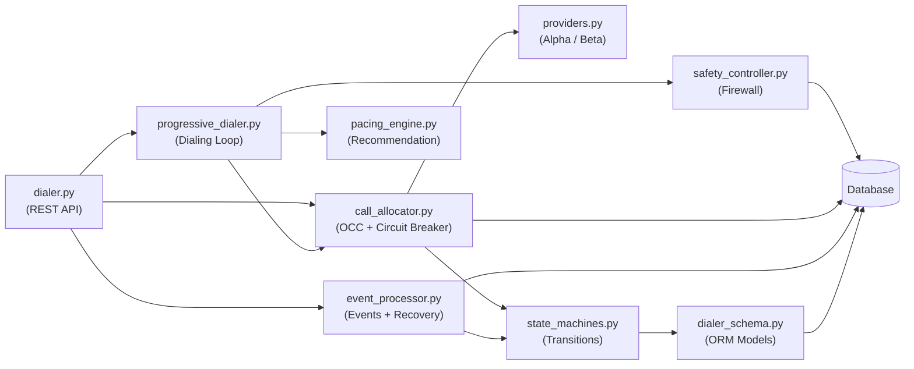
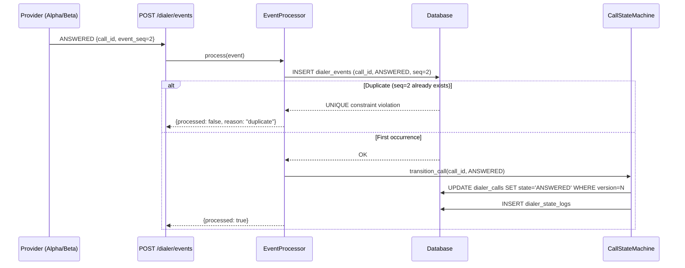

# SmartDialer — Architecture Diagrams

## 1. System Architecture

---

## 2. Agent State Machine

**Valid transitions table:**

| From | To | Trigger |
|---|---|---|
| OFFLINE | AVAILABLE | Agent joins session |
| AVAILABLE | RESERVED | Allocator: OCC UPDATE succeeds |
| RESERVED | DIALING | Provider call initiated |
| RESERVED | AVAILABLE | Timeout recovery / allocation abort |
| DIALING | CONNECTED | `ANSWERED` provider event |
| DIALING | AVAILABLE | `FAILED` provider event |
| CONNECTED | WRAP_UP | `COMPLETED` or `FAILED` provider event |
| WRAP_UP | AVAILABLE | Wrap-up timer expires |
| AVAILABLE | OFFLINE | Agent exits session |

Any other transition raises `InvalidTransition`.

---

## 3. Call State Machine

**Idempotency rule**: `dialer_events(call_id, event_type, event_seq)` has a UNIQUE constraint. If the same event arrives twice with the same `event_seq`, the second insert fails and the event is silently discarded.

**Out-of-order rule**: The call state machine only allows valid forward transitions. A `COMPLETED` event arriving while the call is `RINGING` (skipping `ANSWERED`) raises `InvalidTransition` and is rejected without corrupting state.

---

## 4. Component Dependency Diagram

**Key isolation rule**: `pacing_engine.py` has **no import of** `safety_controller.py`. The pacing engine cannot grant its own recommendations. The Safety Controller is the only gatekeeper between the recommendation and the actual call placement.

---

## 5. Data Flow — Webhook Event

